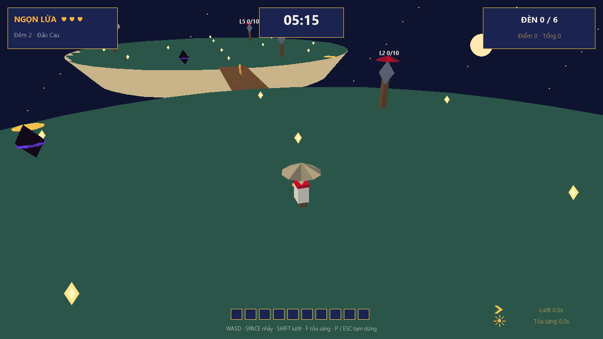

# Đảo Đèn Lồng · Ba hòn đảo

**Phase 2 · Ticket-02 · Test Contract v1.1** — Lê Anh Quân · `2A202603576`

[Bằng chứng Phase 2](docs/proof/phase-2/README.md) ·
[Tiêu chí nghiệm thu / giả định](docs/requirements/phase-2.md) ·
[Bảng chuẩn](docs/requirements/phase-2-standard.md) ·
[Nhật ký AI / retro](docs/notes/phase-2.md)

Video demo cuối lab sẽ thực hiện ở Phase 4. Ticket-03/04 chưa được cung cấp.
Tag `phase-1` và toàn bộ bằng chứng Phase 1 được giữ nguyên để chấm lại.

Mây đội nón lá, mang chiếc đèn nhỏ qua Đảo Bến, Đảo Cau và Đảo Chuông.
Gom đom đóm, nạp đèn, tránh Bóng Mực và Gió Lạc, qua cầu tre và bục nhảy
để mang ánh sáng về trước Bình Minh. Phối cảnh 3D được dựng bằng phần mềm;
Pygame xử lý framebuffer, input và âm thanh. Logic 60Hz dùng chung với headless.



*Ảnh được lưu trực tiếp từ framebuffer trong GUI smoke tự động, không phải
video người chơi. [Đảo Chuông](docs/proof/phase-2/night3.png) ·
[HUD đếm ngược](docs/proof/phase-2/hud-danger.png) ·
[Bảng vật liệu](docs/proof/phase-2/palette.png).*

## Cài và chơi — tối đa 3 lệnh

Cần Python 3.9+ có pip và desktop macOS/Linux/Windows. Lần build đầu cần
mạng để cài Pygame 2.6.1 vào `.runtime` trong dự án; sau đó chơi offline.
Không cần API key, GPU, Tkinter hoặc Pillow.

```bash
git clone https://github.com/quanle28/K5-L3A-DAY12-LeAnhQuan-2A202603576-AI-SDLC-Dao-Den-Long.git
cd K5-L3A-DAY12-LeAnhQuan-2A202603576-AI-SDLC-Dao-Den-Long
python3 tools/build.py --run
```

Đã có repo trên Windows: `python tools/build.py --run`. Sau khi build,
chạy lại bằng `python game.py` (macOS/Linux dùng `python3`).
Build riêng: `python3 tools/build.py`; lệnh manifest không tự mở GUI.
Menu → giới thiệu Ông Đăng → chơi → kết quả → Đêm sau → Bình Minh.
Thua được chơi lại Đêm hiện tại. Điểm tổng chỉ gồm các Đêm đã thắng.

## Điều khiển

| Phím / thao tác | Hành động |
|---|---|
| WASD / mũi tên | Di chuyển theo camera, điều khiển đầy đủ trên không |
| Space | Nhảy khi chạm đất |
| Shift | Lướt 14m/s trong 12tick, hồi 1,5s; đứng yên dùng hướng đang quay |
| E | Nạp ánh sáng vào đèn chưa sáng gần nhất trong 2m |
| F | Tỏa sáng tốn 3 đom đóm, choáng/đẩy Bóng Mực trong bán kính 3D 5m |
| Giữ chuột phải và kéo / Q,C | Xoay camera |
| Esc / P | Tạm dừng: tiếp tục, chơi lại Đêm, cài đặt, về menu |
| R | Chơi lại Đêm đang chơi |
| Enter | Bắt đầu / tiếp tục flow sau kết quả |

Cài đặt âm lượng/độ nhạy được lưu ở `~/.lantern_island/settings.json`.
Có nhạc nền riêng từng Đêm và SFX tự tổng hợp cho các hành động/sự kiện.
Nếu máy không có thiết bị audio, game vẫn chạy; âm thanh cần kiểm tra trên
thiết bị thực, không coi smoke mixer giả lập là nghe thử.

## Luật và điểm chuẩn

Mang tối đa **10** đom đóm; mỗi đèn cần **10**, nạp từng phần được. Chạy
6m/s, nhảy7m/s, gravity−20. Ba lửa, thời lượng **300 / 330 / 360 giây**,
số đèn **5 / 6 / 7**. Đèn sáng chặn Bóng Mực ở vùng6m; Bóng Mực đang trong
vùng lúc đèn sáng bị đẩy ra trong30tick và không gây hit trong lúc đó.

Bị chạm mất1lửa, rơi floor(carried/2) đom đóm trong8giây, bất tử1,5s.
Rơi dướiY−10 bỏ qua bất tử, mất1lửa và toàn bộ đồ; chờ60tick hồi sinh.
Tỏa Sáng hồi3s, choáng120tick và đẩy4m trong15tick. Lướt không bất tử.
Bùa Gió10s tăng chạy7,2m/s và bỏ hồi chiêu lướt; nhặt lại làm mới.

Điểm: **+10 mỗi đom đóm NẠP**, **+100 mỗi đèn**, **+5 mỗi Bóng Mực trúng
Tỏa Sáng**, kể cả đang choáng. Thắng thêm **floor(giây còn lại)×2+50×lửa**.
Ưu tiên kết thúc đúng Ticket-02: **hết lửa → thua; còn sống và đủ đèn → thắng;
còn lại hết giờ → thua**. Tuning ở [game.contract.json](game.contract.json).

Đêm2: cầu tre không lan can, hai bục vàng phóng qua đảo, Gió Lạc cướp đồ.
Đêm3: dùng hai dốc lên tầng1 rồi bục vàng tới tầng chuông; gió mạnh mỗi30s,
báo trước2s. Màu vật liệu đúng bảng chuẩn; ambient=.15+.55×lit/count.

## Headless v1.1

Không cần Pygame, display, GPU hoặc audio khi chỉ chạy headless.

```bash
python3 game.py --headless --seed 12 --night 2 --scenario tests/scenarios/v11/charm.json --inputs tests/scenarios/v11/charm.inputs.json --ticks 30 --snapshot-every 1 --out run.jsonl
```

`--night` nhận1/2/3, snapshot mặc định mỗi10tick. Tick0 chỉ setup, không
cộng điểm/phát event. Input tickk tạo state/event tickk+1. Input vắng giữ
giá trị cũ; jump/interact/pulse/dash/pause kích hoạt khi false→true.
Pause vẫn tăng tick, đóng băng sim_tick và mọi counter/spawn/TTL; snapshot
state paused. JSONL đủ snapshot/event/end v1.1, tọa độ3decimals và ID tất định.
`--ticks 0` chỉ snapshot0 và end. File sai exit2+stderr; lỗi output exit1.

Scenario v1.0 vẫn nhận; v1.1 thêm counters/player, shade state/timer,
drifters/charms và flags. Schema cho các field chưa ghi chi tiết trong
ticket được nêu tại [spec](docs/requirements/phase-2.md), không ẩn giả định.

## Kiểm chứng

```bash
python3 tools/verify.py
```

Gate chạy build, **58 test**, **14 scenario hai lần để so từng byte**,
bot thắng Đêm1 bằng input hợp lệ và benchmark trọn ba Đêm ≤30s/Đêm.
Lưu log, JSONL, hash nguồn và môi trường ở `docs/proof/phase-2`.

- `python3 tools/gui_smoke.py`: GUI flow, pause/settings/audio/HUD, ảnh và FPS
  cả3Đêm ở1280×720; FPS<30 thì exit khác0. Cần desktop hoặc Xvfb trên Linux.
- `python3 tools/stress_renderer.py`: đo thêm khi đủ6/8/10 Bóng Mực.
- `python3 tools/clean_check.py`: cài/build/test/replay trong thư mục sạch.
- `python3 tools/verify.py --check-only`: không sửa proof, dùng cho pre-commit.
- `python3 tools/render_png.py` / `tools/export_scene.py`: xuất hình/SVG offscreen.

Hook chặn commit test đỏ: `git config core.hooksPath .githooks`.
CI kiểm tra headless trên Windows/macOS/Linux và desktop Linux/Xvfb.
Số đo local có trong JSON, không coi đó là kết quả trên máy chấm chung.
Test ẩn của giảng viên và đánh giá độc lập/chơi tay/nghe thật chưa có.

## Sáng tạo của tôi

Giữ nón lá/đèn nhỏ, hình khối cổ tích, sao/biển mây, vòng Tỏa Sáng, ánh sáng
ấm khi thắp đèn; thêm các giai điệu PCM gốc cho từng Đêm. Trang trí và nhạc
không dùng RNG gameplay hoặc thêm thực thể headless. Các replay deterministic
và test hồi quy là bằng chứng phần sáng tạo không làm đổi contract.

Tài liệu đề bài gốc: [README gốc](docs/lab/README.original.md), [GUIDE](GUIDE.md),
[RUBRIC](RUBRIC.md), [RULES](RULES.md), [SUBMISSION](SUBMISSION.md).
[CREDITS](CREDITS.md) · [LICENSE](LICENSE) · [CHANGELOG](CHANGELOG.md)
