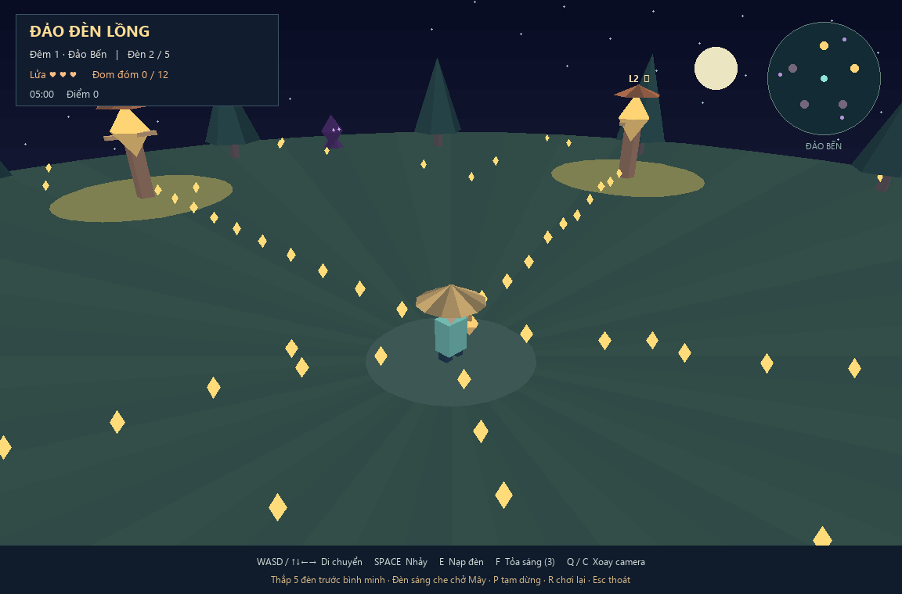

# Đảo Đèn Lồng · Đêm 1 – Đảo Bến

**Phase 1 · PRD-0 / Test Contract v1.0** · Lê Anh Quân · `2A202603576`

[Bằng chứng chạy thật](docs/proof/phase-1/README.md) ·
[Yêu cầu và giả định](docs/requirements/phase-1.md) ·
[Nhật ký AI / retro](docs/notes/phase-1.md)

Video demo cuối lab: chưa có; sẽ thực hiện khi đến Phase 4. Phase 2–4 chờ
ticket được công bố. Tài liệu README đề bài gốc được giữ tại
[docs/lab/README.original.md](docs/lab/README.original.md); GUIDE, RULES,
RUBRIC, CHECKPOINTS và SUBMISSION vẫn ở thư mục gốc.

Mây đội nón lá, mang chiếc đèn nhỏ đi qua đảo giữa biển mây. Gom đom đóm,
nạp cho năm Đèn Lồng Lớn, dùng ánh sáng xua Bóng Mực và giữ lửa trước bình minh.
Game dùng phối cảnh 3D bằng phần mềm, camera bám sau nhân vật, không cần GPU,
mạng hay tải asset lúc chơi. Logic GUI và headless là cùng một mô hình.



*Ảnh trên là bản xuất offscreen từ cùng renderer của game, không phải ảnh
chụp một phiên chơi trực tiếp.*

## Chạy game (macOS / Linux)

Điều kiện: Python 3.9+ có Tkinter. Python từ python.org có bản Tk đi kèm;
Ubuntu/Debian nếu thiếu Tk thì cài gói hệ điều hành `python3-tk`.
Không cần pip, npm, API key hoặc thư viện Python bên ngoài.

```bash
git clone https://github.com/quanle28/K5-L3A-DAY12-LeAnhQuan-2A202603576-AI-SDLC-Dao-Den-Long.git
cd K5-L3A-DAY12-LeAnhQuan-2A202603576-AI-SDLC-Dao-Den-Long
python3 game.py
```

Windows: trong thư mục dự án chạy `python game.py`. Nhấn **Enter** để bắt đầu.
Lệnh build được khai báo trong manifest: `python3 tools/build.py` (kiểm tra và
biên dịch Python, không tải dependency). macOS/Linux có CI được cấu hình;
kết quả đo đã lưu trong repo hiện được tạo trên Windows, không giả nhận đã
chơi thử thủ công trên hệ điều hành khác.

## Điều khiển và luật

| Phím | Hành động |
|---|---|
| WASD / mũi tên | Di chuyển theo hướng camera |
| Space | Nhảy |
| E | Nạp số đom đóm đang mang vào đèn gần nhất trong 2,5m |
| F | Tỏa sáng, tốn 3 đom đóm, choáng và đẩy Bóng Mực trong 5m |
| Q / C | Xoay camera |
| P | Tạm dừng / tiếp tục |
| R | Chơi lại từ đầu, kể cả sau thắng/thua |
| Enter | Bắt đầu / chơi lại sau kết thúc |
| Esc | Thoát |

Mỗi đèn cần 10 đom đóm, cho nạp từng phần. Mây mang tối đa 12, có 3 lửa và
300 giây. Đèn sáng tạo vùng an toàn 4m. Bị chạm mất 1 lửa, rơi 25% số mang
(làm tròn xuống, tan trong sương), bất tử 2 giây. Rìa đảo chặn bước, không
phạt rơi. Nhảy không tránh sát thương vì khoảng cách gameplay tính XZ.
Minimap ở góc phải: Mây xanh ngọc, Bóng Mực tím, đèn sáng vàng.

Thắp đủ 5 đèn thắng; hết lửa hoặc bình minh thua. Điểm: **+10/đom đóm,
+100/đèn, +20/Bóng Mực trúng pulse**. Khi thắng thêm **2 × số giây còn lại
làm tròn xuống + 50 × số lửa còn lại**, chỉ cộng một lần.
Thông số thực dùng được đọc trực tiếp từ [game.contract.json](game.contract.json).
Các giả định về thứ tự xử lý và trường hợp đồng thời ở tài liệu yêu cầu.

## Headless đúng Test Contract v1.0

```bash
python3 game.py --headless --seed 12 --night 1 --scenario tests/scenarios/pickup-deposit.json --inputs tests/scenarios/pickup-deposit.inputs.json --ticks 130 --out run.jsonl --snapshot-every 10
```

Bỏ scenario/inputs để dùng màn mặc định và đứng yên. `--ticks 0` chỉ xuất
snapshot tick 0 và end. Không import GUI, không cần display, chạy nhanh nhất
có thể. Đơn vị mét, Y lên, khoảng cách XZ, bước cố định 1/60 giây.
Snapshot tick 0 là setup; input tick k tạo state/event tick k+1; nút kích
hoạt khi false→true, trường input vắng giữ nguyên. JSONL kết thúc bằng end;
lỗi input/scenario exit 2 + stderr, lỗi ghi output exit 1.

## Kiểm tra và tái tạo bằng chứng

```bash
python3 tools/verify.py
```

Một lệnh chạy build, 31 unit/integration tests, 5 scenario hai lần để so
byte, lượt chơi từ đầu tới thắng và benchmark 18.000 bước. Log, JSONL,
SHA-256 nguồn và thông tin môi trường lưu ở `docs/proof/phase-1/`.

- Test riêng: `python3 -m unittest discover -s tests -v`.
- Không ghi proof: `python3 tools/verify.py --check-only`.
- Thư mục sạch: `python3 tools/clean_check.py`.
- GUI smoke (cần display/Tk): `python3 tools/gui_smoke.py`.
- Xuất cảnh SVG: `python3 tools/export_scene.py`.
- Xuất PNG QA tùy chọn: cài Pillow vào `.qa` rồi `python3 tools/render_png.py`.
  Game/headless không cần Pillow; `.qa` không commit.

Harness: [AGENTS.md](AGENTS.md), [pre-commit](.githooks/pre-commit) và
[CI](.github/workflows/verify.yml). Bật hook local bằng
`git config core.hooksPath .githooks`. Hook chạy kiểm chứng trong thư mục
tạm; test đỏ chặn commit, không ghi đè bằng chứng đã stage.
CI chạy headless trên Linux/macOS/Windows và GUI smoke trên Linux với Xvfb.

## Sáng tạo của tôi

Năm đường đom đóm dẫn tới các đèn; nón lá hình học và đèn nhỏ của Mây;
bầu trời sao/biển mây; đảo đổi sắc khi sáng đèn; minimap và vòng pulse.
Trang trí không dùng RNG gameplay và không thêm thực thể headless.
Hai ảnh [ban đầu](docs/proof/phase-1/scene-start.png) /
[đã sáng](docs/proof/phase-1/scene-lit.png) và các replay deterministic
là bằng chứng tương ứng. Không có asset tải ngoài hay nhạc bản quyền.

## Giới hạn đã biết

Đồ họa phần mềm đơn giản, không có hiệu ứng bóng đổ GPU. FPS phụ thuộc
Tk/máy; số đo của máy hiện tại ở `gui-smoke.json`, không áp ngưỡng của
Ticket-04 chưa công bố. Chưa có đánh giá độc lập, video chơi tay hoặc kết
quả test ẩn của giảng viên. Các mục này không được ghi là đã đạt.

[CREDITS](CREDITS.md) · [LICENSE](LICENSE) ·
[Hướng dẫn nộp của lab](SUBMISSION.md)
