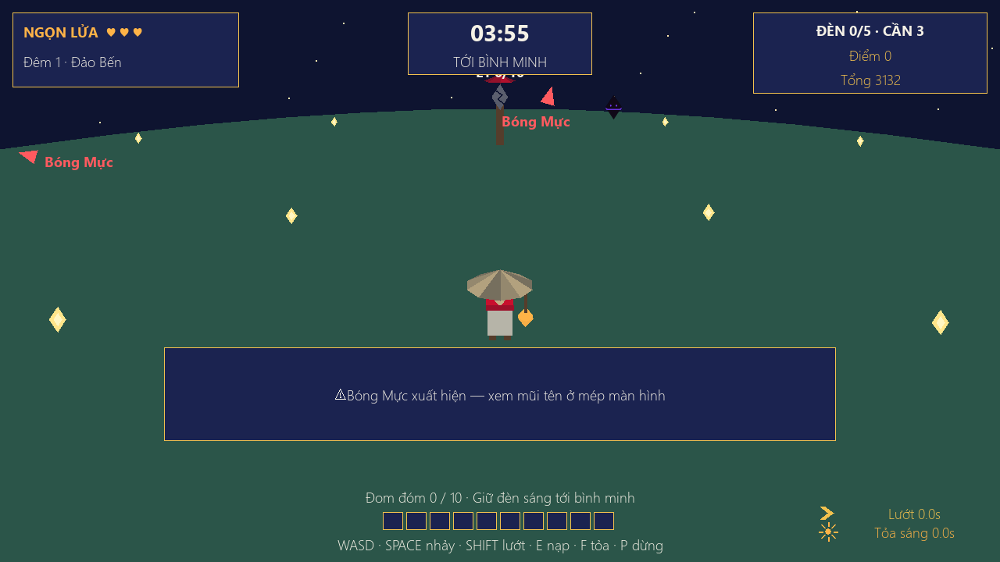

# Đảo Đèn Lồng · Bình minh v1.0.0

🎬 **[Video demo MP4 — 72 giây](docs/demo/demo.mp4)** ·
**[Tải bản chạy Windows / Linux / macOS](https://github.com/quanle28/K5-L3A-DAY12-LeAnhQuan-2A202603576-AI-SDLC-Dao-Den-Long/releases/tag/v1.0.0)**

Phase4 · Contract **1.3** · Lê Anh Quân · `2A202603576`.
Game3D nhỏ: Mây đội nón lá, thu đom đóm, thắp/châm dầu, tránh Bóng Mực và
giữ đảo sáng tới bình minh qua Đảo Bến → Đảo Cau → Đảo Chuông.



Ảnh từ cửa sổ GUI trong kiểm thử tự động. Video ghi framebuffer trực tiếp,
**phím được tự động hóa**; có fixture minh họa đặt gần đèn và xem trước map2/3,
được ghi rõ trong clip. Đây không phải chứng nhận người chơi thắng cả3Đêm.

## Cài và chơi — tối đa3lệnh

Máy có desktop Windows10/11, macOS hoặc Linux, Python3.9+ có pip, màn hình
1280×720, chuột/bàn phím; khuyến nghị2GBRAM trống. Renderer software không cần
GPU riêng/API key. Cần mạng lúc build đầu; game chạy offline sau đó.

```bash
git clone https://github.com/quanle28/K5-L3A-DAY12-LeAnhQuan-2A202603576-AI-SDLC-Dao-Den-Long.git
cd K5-L3A-DAY12-LeAnhQuan-2A202603576-AI-SDLC-Dao-Den-Long
python3 tools/build.py --run
```

Windows có thể dùng `python` thay `python3`. Build cài Pygame2.6.1 và
psutil6.1.1 vào `.runtime` của repo. Mở lại bằng `python3 game.py`.
Linux cần desktop SDL/X11/Wayland và thư viện âm thanh hệ thống thông thường.

Bản ZIP standalone trong Release không cần cài Python: giải nén **cả thư mục**
`DaoDenLong`, chạy `DaoDenLong.exe` trên Windows hoặc `./DaoDenLong` trên Linux/macOS
(nếu ZIP mất quyền thực thi: `chmod +x DaoDenLong`). Linux build Ubuntu22.04 x64;
macOS14 arm64; Windows x64. Bản macOS chưa ký/notarize, có thể cần cho phép mở
trong cài đặt bảo mật hệ thống. Nguồn Python là lựa chọn cho kiến trúc khác.

## Chơi và điều khiển

Menu → giới thiệu → chơi → kết quả → Đêm tiếp theo → Bình Minh.
**Map2 mở sau khi thắng Đêm1 rồi chọn “Đêm tiếp theo” / Enter.**
Thua được ghi danh rồi chơi lại đúng Đêm đó. Thắng Đêm3 được lưu tổng điểm.

| Phím mặc định | Hành động |
|---|---|
| WASD / mũi tên | Di chuyển theo camera |
| Space / Shift | Nhảy / lướt |
| E | Nạp/châm dầu đèn nhận được gần nhất |
| F | Tỏa Sáng, tốn3đom đóm |
| Giữ chuột phải / Q,C | Xoay camera; Q,C tự nhường nếu được gán hành động |
| Esc / P | Tạm dừng; tiếp tục/chơi lại/cài đặt/về menu |

Cài đặt → **Đổi phím** cho cả9hành động, báo trùng, khôi phục mặc định.
Cài đặt lưu âm lượng, độ nhạy chuột, bảng màu dễ phân biệt, giảm chuyển động,
chữ lớn×1.25. Mọi chữ UI ít nhất18px ở1280×720. Không có rung camera/chớp
toàn màn hình; giảm chuyển động còn dừng bob/chiếc lá và vòng pulse giãn nở.
Thanh dầu nhấp nháy1Hz vẫn là chỉ báo luật. Phụ đề/mũi tên báo bóng xuất hiện,
gió sắp thổi,10giây cuối,đèn dầu thấp hoạt động cả khi tắt âm thanh.

## Luật và điểm (giữ nguyên Phase3)

- **Không thắng sớm**. Sống tới hết240/270/300giây, còn ít nhất3/5,4/6,5/7đèn
  sáng mới thắng. Hết lửa luôn thua trước, kể cả tick bình minh.
- Thắp đầu10đom đóm; đèn có100dầu, hao1/giây; E thêm10dầu/mote, tốiđa100.
  Hết dầu tắt; thắp lại5mote. Dầu≥30 có vùng an toàn6m; dưới30 có thể bị
  bóng wander hút5dầu/giây/con. Châm lên≥30 đẩy bóng ra mép trong30tick.
- Sức chứa10+2×số lần thắp thành công, tốiđa20, reset mỗi Đêm.
- +5/mote nạp/châm; +100thắp đầu/+40thắp lại; +5/bóng trúng pulse, **tổng15**
  nếu đang hút dầu. Thắng: mỗi đèn sáng +50+floor(dầu), mỗi lửa +50.
  Tổng game chỉ cộng **các Đêm đã thắng**, không cộng điểm Đêm thua.
- Đêm2/3 có Gió Lạc cướp đom đóm và Bùa Gió. Bục nhảy, cầu tre, tầng/dốc,
  gió giữ nguyên bản đồ/số liệu chuẩn. [ADR thay luật](docs/adr/0003-fuel-and-dawn.md).

## Dữ liệu và bảng xếp hạng

Top10 trên menu, điểm giảm dần, bằng điểm thì đạt trước đứng trước. Tên3–12
chữ/số/underscore, hỗ trợ thêm tiếng Việt. Lưu `name,score,nights_won,
achieved_at` có múi giờ,`seed`. Dữ liệu ở `~/.lantern_island/`, gồm
`settings.json` và `leaderboard.json`; ghi nguyên tử và giữ backup nếu file điểm hỏng.
Có thể đổi bằng `--data-dir PATH` hoặc biến `LANTERN_DATA_DIR`.

```bash
python3 game.py --export-leaderboard out.json
```

## Headless, test, benchmark, soak

Manifest [game.contract.json](game.contract.json) khai đầy đủ lệnh/tuning.
Gameplay headless chỉ cần stdlib, không cửa sổ/GPU/audio.60tick/giây cố định,
input rising-edge/persistence, tick0setup, JSONL snapshot/event/end; lỗi
input/scenario exit2. --night1/2/3, pause đứng sim_tick/counters nhưng tick vẫn tăng.

```bash
python3 game.py --headless --seed 12 --night 1 --scenario tests/scenarios/v12/dawn-relight.json --inputs tests/scenarios/v12/dawn-relight.inputs.json --ticks 1 --snapshot-every 1 --out run.jsonl
python3 tools/verify.py
python3 game.py --benchmark --seed 42 --duration 30 --out bench.json
python3 game.py --soak --seed 7 --nights 10 --out soak.json
```

Gate: **96test**,28scenario CLI lặp2lần, replay maintenance120s và3Đêm đầy đủ.
`tools/regression_phase3.py` đối chiếu28đầu ra CLI với tag Phase3 từng byte.
`tools/gui_smoke.py` kiểm UI/input/persistence/audio dummy/FPS;
`tools/stress_renderer.py` đủ6/8/10bóng; `tools/clean_check.py` build thư mục sạch.
Pre-commit chạy gate `--check-only`, không sửa proof. CI cả Windows/macOS/Linux.

Benchmark mở cửa sổ1280×720, software SDL **vsync0, không limiter**; warm3s rồi
đo30s. Đúng200wander/100mote/3đèn100dầu; không spawn/hit/pickup/decay/end;
camera R30/Y15/15s vòng. Cùng renderer/LOD với game, không hạ chất lượng riêng.
Sao/trăng/lá trang trí tắt trong bench; headless soak không chạy phần đồ họa sáng tạo.
`bench.samples.json` giữ raw dt. p95 nội suy tuyến tính type7; RSS psutil mỗi frame,
đơn vịMiB. Soak cùng một PID, chỉ sối bắt đầu0: seed7+i,reset mỗi Đêm, RSS sau
tải đầu và reset cuối+gc. Đầu vào ngẫu nhiên khiến cả10lượt local thua là hợp lệ.

Số đo local: **123,1FPS trung bình / 58,2FPS 1%low / load307ms**;
soak **0crash,16,27→16,34MiB**. Ngưỡng cuối cùng vẫn đo trên máy chấm của giảng viên.
[Bằng chứng Phase4](docs/proof/phase-4/README.md) · [bench](bench.json) · [soak](soak.json).
Chưa có test ẩn hoặc người chơi/nghe thử độc lập; audio smoke chỉ kiểm PCM/mixer dummy.

## Phát hành, harness và sáng tạo

`tools/package_release.py --install` tạo ZIP executable+runtime notices và smoke-test
headless/export/soak. Workflow release đóng gói3hệ, xuất bản tagv1.0.0 kèm video/bench/soak.
Video tái tạo bằng `tools/record_demo.py` (dev encoder imageio-ffmpeg0.6.0).
[Retro4phase](docs/notes/retro.md) · [Spec Phase4](docs/requirements/phase-4.md) ·
[AGENTS.md](AGENTS.md) · [Changelog](CHANGELOG.md).

**Sáng tạo của tôi:** Mây/nón lá/đèn nhỏ, sao/biển mây, nhạc/SFX PCM tự tổng hợp,
giấy đèn rách/xẹp và cảnh báo vector. Trang trí chỉ ở GUI; không đổi RNG/headless.
Regression28ca chứng minh gameplayPhase3 giữ nguyên. Giữ nguyên tag/proof cả4phase;
nguồn đề bài và lịch sử quyết định ở docs. Không dùng asset tải ngoài.

[Đề bài gốc](docs/lab/README.original.md) · [RULES](RULES.md) · [RUBRIC](RUBRIC.md) ·
[SUBMISSION](SUBMISSION.md) · [CREDITS](CREDITS.md) · [LICENSE](LICENSE)
