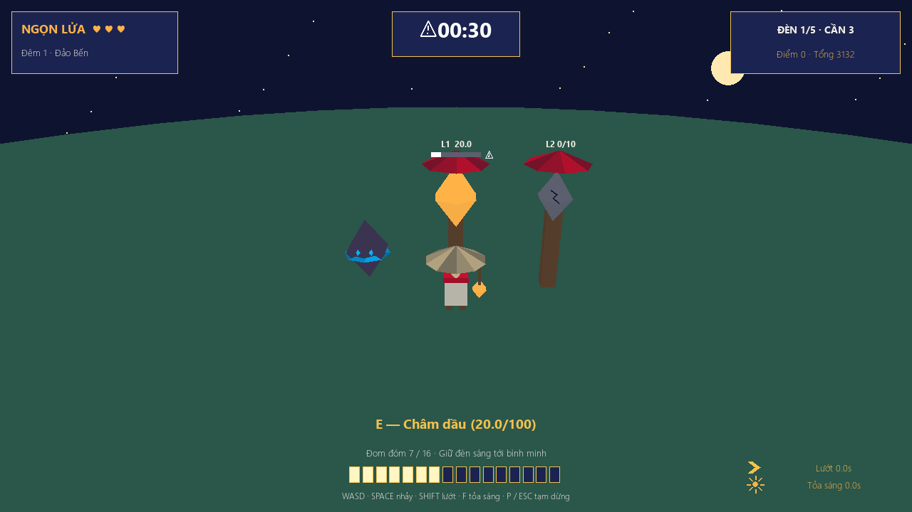

# Đảo Đèn Lồng · Đèn cạn dầu

**Phase 3 · Ticket-03 · Test Contract v1.2** — Lê Anh Quân · `2A202603576`

[Proof Phase3](docs/proof/phase-3/README.md) · [Spec](docs/requirements/phase-3.md) ·
[ADR về thay luật](docs/adr/0003-fuel-and-dawn.md) · [AI log / retro](docs/notes/phase-3.md)

**Luật mới: thắp hết đèn chưa thắng.** Mây phải sống đến bình minh và giữ ít
nhất **3/5, 4/6, 5/7 đèn sáng** tương ứng ba Đêm. Thắng Đêm1 rồi chọn
**Đêm tiếp theo / Enter** mới chuyển sang map2. Thời lượng: **240/270/300 giây**.
Hết lửa luôn thua, kể cả tick bình minh. Đóng phiên game cũ rồi mở lại để dùng luật mới.



*Framebuffer thật từ GUI smoke tự động, không phải clip chơi tay. So sánh
[nửa chu kỳ tắt](docs/proof/phase-3/colorblind-low-off.png) /
[sau châm dầu](docs/proof/phase-3/refueled.png).*

## Cài và chơi — 3 lệnh

Python3.9+ có pip và desktop Windows/macOS/Linux. Build cài Pygame2.6.1
vào `.runtime` trong repo (cần mạng lần đầu); sau đó chơi offline.
Không cần API key, GPU, Tkinter hay Pillow.

```bash
git clone https://github.com/quanle28/K5-L3A-DAY12-LeAnhQuan-2A202603576-AI-SDLC-Dao-Den-Long.git
cd K5-L3A-DAY12-LeAnhQuan-2A202603576-AI-SDLC-Dao-Den-Long
python3 tools/build.py --run
```

Đã có repo trên Windows: `python tools/build.py --run`. Chạy lại sau build:
`python game.py` (macOS/Linux dùng `python3`). Menu → giới thiệu → chơi → kết
quả → Đêm sau → Bình Minh. Pause có tiếp tục/chơi lại/cài đặt/về menu.

| Điều khiển | Hành động |
|---|---|
| WASD / mũi tên | Di chuyển theo camera |
| Space / Shift | Nhảy / lướt |
| E | Nạp đèn tắt hoặc châm dầu đèn sáng gần nhất nhận được |
| F | Tỏa Sáng, tốn3đomđóm, choáng/đẩy Bóng Mực |
| Giữ chuột phải / Q,C | Xoay camera |
| Esc / P | Tạm dừng |
| R | Chơi lại Đêm |

## Dầu, sức chứa, điểm

- Đèn sáng có100dầu, hao1/giây. E châm10dầu/mote theo ceil phần thiếu, tốiđa100.
  Đèn thật sự đầy không nhận. Hết dầu tắt, reset tiến độ; lần đầu cần10mote,
  thắp lại chỉ5. Dầu tính chính xác theo unit1/60, chỉ làm tròn lúc xuất.
- Dầu≥30 có vùng bảo vệ6m. Dầu<30 mất bảo vệ, nhấp nháy1Hz và có thể bị
  Bóng Mực wander tìm tới hút5dầu/giây/con. Tỏa Sáng ngắt drain; châm lên≥30
  đẩy bóng trong vùng ra ngoài trong≤30tick, không gây hit khi đang đẩy.
- Sức chứa **10+2×số lần thắp thành công**, cap20, gồm tái thắp; reset mỗi Đêm.
  HUD hiển thị đang mang/sức chứa. Đèn dựng sẵn trong scenario không tăng counter.
- Điểm mới: +5/mote nạp hoặc châm; +100thắp đầu/+40thắp lại;
  +5/shade trúng pulse, **tổng15** nếu nó đang drain. Khi thắng: mỗi đèn sáng
  +50+floor(dầu) và mỗi lửa +50. **Không thưởng thời gian**; tổng chỉ cộng Đêm thắng.
- Gió Lạc, Bùa Gió, nhảy/lướt, rơi/hồi sinh, bản đồ và âm thanh giữ từ Phase2.

Cài đặt **Bảng màu dễ phân biệt** được lưu cùng âm lượng/độ nhạy tại
`~/.lantern_island/settings.json`: shade viền/mắt xanh#00B3FF; cảnh báo trắng
kèm tam giác ⚠ vẽ vector. Đèn tắt có giấy rách và thân giấy xẹp20%, phân biệt
không cần màu. [Changelog breaking changes](CHANGELOG.md).

## Headless v1.2 / kiểm chứng

Headless dùng stdlib, không cần Pygame/display/audio. Lệnh ví dụ tick bình minh
đèn vừa hết dầu nhưng được thắp lại kịp:

```bash
python3 game.py --headless --seed 12 --night 1 --scenario tests/scenarios/v12/dawn-relight.json --inputs tests/scenarios/v12/dawn-relight.inputs.json --ticks 1 --snapshot-every 1 --out run.jsonl
```

Giữ CLI v1.1, night1/2/3, tick0 setup, input persistence/rising-edge,
60Hz, tick/sim_tick khi pause, JSONL snapshot/event/end, malformed exit2.
Thêm fuel/ever_lit/relit_count, capacity, drain/target, refuel/lantern_out/
fuel_drain, dawn_survived; `all_lit` không còn là reason. Snapshot fuel1decimal,
nhưng threshold và bonus floor dùng giá trị nguyên chưa làm tròn.
Manifest: [game.contract.json](game.contract.json).

```bash
python3 tools/verify.py
```

Gate chạy build, **83test**, **28scenario replay2lần**, maintenance challenge
120s và full-night benchmarks≤30s. Log/hash nguồn/môi trường ở proof Phase3.
Scenario v1.1 không bị thay vẫn chạy; ba scenario thắng sớm đã được thay bằng
ca bình minh, có ghi rõ trong ADR/retro, không skip âm thầm.

- `python3 tools/gui_smoke.py`: flow/settings/accessibility/fuel blink/HUD và≥30FPS1280×720.
- `python3 tools/stress_renderer.py`: đủ6/8/10shade và tất cả đèn sáng có dầu.
- `python3 tools/clean_check.py`: cài/build/test/replay trong thư mục sạch.
- `python3 tools/verify.py --check-only`: gate không sửa proof, dùng cho pre-commit.
- `python3 tools/render_png.py` / `tools/export_scene.py`: xuất offscreen PNG/SVG.

CI headless Windows/macOS/Linux và GUI Linux/Xvfb. Số đo local không đại diện
máy chấm. Chưa có test ẩn, chơi/nghe thử độc lập hoặc video demo cuối lab.
Audio smoke dùng mixer dummy, không giả nhận là đã nghe trên loa.

## Sáng tạo của tôi / lịch sử

Giữ nón lá/đèn nhỏ, biển mây, sao, vòng pulse, nhạc PCM gốc. Điều chỉnh ánh
sáng theo đèn đang cháy, thêm giấy rách và cảnh báo vector không phụ thuộc font.
Trang trí/cài đặt không đổi RNG hay output headless; có test model bất biến khi
đổi palette. Tag/proof `phase-1` và `phase-2` giữ nguyên. Ticket04 chưa nhận;
video và Releasev1.0.0 chờ Phase4.

[README đề bài gốc](docs/lab/README.original.md) · [RULES](RULES.md) ·
[RUBRIC](RUBRIC.md) · [SUBMISSION](SUBMISSION.md) · [CREDITS](CREDITS.md) · [LICENSE](LICENSE)
